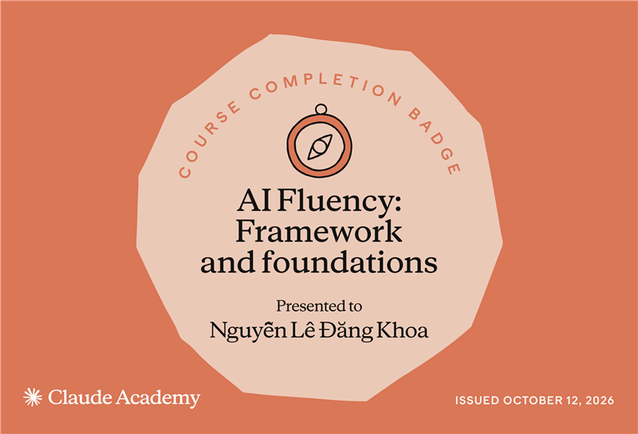

## Welcome to my github profile 👋

My name is Khoa and my nickname is Sorai.

I'm currently an IT student majoring Software Engineering at University of Management and technology Ho Chi Minh City.

Currently working on: personal and academic projects. Still trying learn new techs and tools to create my own coding style.

I am quite a big fan of competitive programming, the practice platforms I have been learning on are:

Codeforces 
&nbsp;&nbsp;&nbsp;•&nbsp;&nbsp;&nbsp;
VNOI 
&nbsp;&nbsp;&nbsp;•&nbsp;&nbsp;&nbsp;
CSES 
&nbsp;&nbsp;&nbsp;•&nbsp;&nbsp;&nbsp;
HackerRank 

### 🏅 My Badges & Certifications

#### Claude Academy

<!--
  HOW TO ADD A BADGE
  1. Save the badge image into assets/badges/ (e.g. assets/badges/claude-101.png).
  2. Copy one whole <td>...</td> block below and paste it right after the last <td>.
     Edit 3 things: certificate link (twice), image path, badge name.
  3. Every 3 badges, close the row with </tr> and open a new one with <tr>.
  4. For another provider (e.g. Google, Coursera), copy the "#### Claude Academy" heading
     and the whole <table> below it, and change the heading text.
-->
<table>
  <tr>
    <td align="center" valign="top" width="240">
       
      <a href="https://academy.claude.com/verify/1f4c6317ca53b24b761047571d231af7"><b>Claude Code 101</b></a>
    </td>
    <td align="center" valign="top" width="240">
       
      <a href="https://academy.claude.com/verify/06ad8ff6b17a8a9f74f2debb6ef174f2"><b>AI Fluency: Framework and foundations</b></a>
    </td>
  </tr>
</table>

Some fun facts about me:

- I love playing and watching football/soccer. I am also fond of watching academic/entertaining Youtube videos and anime.
- My favorite food and drink are: Fried rice and Coffee.
- I usually bring a cute flushie friend with me whenever and whereever I go
